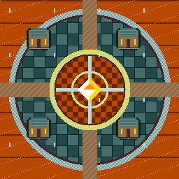

# Scaling Lab: The Brass Orrery

An original native-resolution observatory mosaic demonstrates the Mega CD's
actual graphics ASIC: zoom, rotation and a repeating perspective floor. A
separate floating wisp keeps moving while completed ASIC images are uploaded.
The art and controls are examples, not a prescribed game style.



## Build and open

Generate a new folder with the skill's `scripts/create_project.py`, then:

```sh
docker pull ewrogers/megadev:latest
docker run --rm --cpus=2 --mount "type=bind,source=$PWD,target=/workspace" ewrogers/megadev:latest build
docker run --rm --cpus=2 --mount "type=bind,source=$PWD,target=/workspace" ewrogers/megadev:latest cue scaling_lab.iso
```

Use an absolute mount path. PowerShell can use `${PWD}`. Docker must run Linux
containers; native ARM64 and AMD64 are supported. Unix users can add
`--user "$(id -u):$(id -g)"` for host-owned output. A custom project ID changes the
ISO/CUE name. Open the CUE with your own configured Mega CD BIOS. On macOS:

```sh
open -a ares --args --system 'Mega CD' "$PWD/scaling_lab.cue"
```

Create a fresh review copy for `build REGION=EU VIDEO=PAL` or `build TOUR=1`.
Do not rebuild an image while the emulator has it open. No BIOS is included.

## Controls

Typical configured ares mappings are arrows, J/K/L for A/B/C, and Enter for Start.

| Input | Result |
| --- | --- |
| A | Cycle Zoom, Orbit, Floor |
| Left / Right | Turn; disable automatic heading |
| Up / Down | Change source sampling scale |
| B | Toggle automatic heading |
| C | Reset to Orbit |
| Start | Hold/resume new transforms; pending work finishes safely |

IMAGES counts completed uploads in hexadecimal. IMAGE/S shows new images over
the last 50/60 serviced VBlanks in decimal; it is not the game loop FPS or a
physical-console timing guarantee. The ASIC image is 128×128.
A larger sampling step zooms out; floor mode changes its depth scale. The floor
uses a repeated 256px source, so it is a flat tiled-ground illusion rather than
a 3D world. ERRORS should remain zero. A fault preserves the last displayed
image and quarantines the operation rather than reusing uncertain memory.

The automatic tour cycles all three views and only reports AUTO PASS after
completed images from every view. The wisp and Main/Sub counters are independent
of the ASIC image cadence. This Lab is intentionally silent; it does not claim
that CD reads/audio/ASIC work have been qualified together.

## Implementation and costs

Sub owns ASIC configuration and its 2M Word RAM operation. It builds fixed-point
trace vectors, starts the sampler, waits for completion, then returns ownership.
Main checks both reply and ownership before copying an 8 KiB resident snapshot.
The next ASIC render overlaps upload, but cannot replace the resident snapshot
until its last transfer finishes. The original-68000 MOVEM copy is fixed at 8 KiB.
The VBlank publisher uploads at most 4 KiB image data per accepted early blank,
then commits the hidden tile bank after two chunks. Two 8 KiB VRAM banks avoid
showing partially uploaded images. Palettes are initialized display-off.

`scale_*` is project code, not a Megadev SDK API. The fixed stamp/map/trace/image
layout and Main/Sub protocol are documented in the skill references. The source
mosaic uses exactly one hardware palette line; it was drawn procedurally at
256×256 with no resizing, antialiasing or color quantization. `make_art.py` and
`make_font.py` rebuild the packaged bytes using Python's standard library.

The inverse transform uses a sine lookup, bounded fixed point, a reciprocal
floor table and an original-68000 signed multiply primitive. This avoids
unprovided wide C arithmetic helpers without assuming later CPU instructions.
Source, map, trace and output do not overlap. The Lab's shared bootstrap retains
`LICENSE.megadev`; ROOM.MMD is only a startup/ABI fixture.

Host and compiled CPU tests check bounds, all headings/scale modes, Word RAM
ownership, delayed/stalled completion, stale replies, late VBlank deferral and
whole-image publication. Their ASIC/BIOS models do not prove real hardware
performance. Physical ASIC timing, bus contention, VDP/FIFO deadlines, stack
maxima, BIOS/model variants and combined CD/audio/DMA workloads need separate
qualification. See the installed skill's testing reference.
